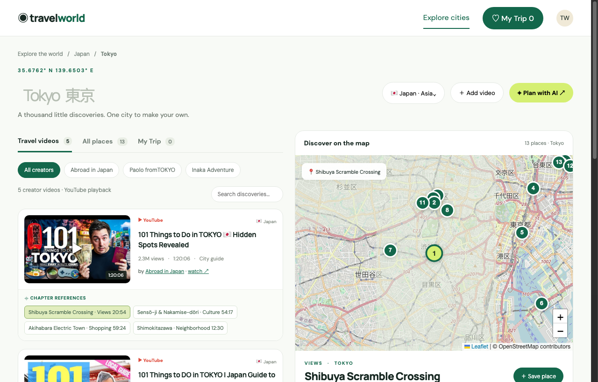

  <b>English</b> | <a href="#chinese"><b>中文说明</b></a>

# AILatest Travel World · First-Person 4K City Walking Explorer 🗺️

  <b>See how real travelers navigate cities before deciding where to go.</b> 
  城市旅行 · 4K 第一视角实景漫游。精选全球 25+ 热门城市 125 条长镜头漫步实况，联动高精度交互地图与 AI 行程规划。

  
  
  
  

---

## 🖼 Visual Showcase

### 1. Official Cover Art

  

### 2. Live Application Interface

  

<em>Live screenshot captured from production: <a href="https://travel.ailatest.org/">travel.ailatest.org</a>.</em>

---

## 🌟 Key Features

1. **Global City Coverage**: Spans 25 metropolises across Asia, Europe, the Middle East, North America, and Oceania (Tokyo, Seoul, London, Paris, New York, etc.).
2. **125 Long-Take 4K Walking Videos**: Curated from verified creators (e.g. *Abroad in Japan*, *Paolo fromTOKYO*), capturing real street atmospheres, ambient sounds, and local transit.
3. **Synchronized Chapter Map Markers**: Every video chapter (e.g. *Shibuya Scramble Crossing*, *Sensō-ji Temple*, *Akihabara Electric Town*) is geocoded onto an interactive Leaflet/OpenStreetMap.
4. **"Plan with AI" Trip Brief Export**: One-click prompt generation formatting your saved spots into structured itinerary briefs for ChatGPT, Gemini, or Claude.
5. **"My Trip" Saved Spots Drawer**: Save spots while watching to compile your personal custom travel itinerary.

---

### 🏷 Related Topics & Search Keywords
`walking-tour-4k` · `first-person-travel` · `city-walking-videos` · `travel-explorer` · `interactive-travel-map` · `tokyo-walking-tour` · `leaflet-travel-map` · `plan-with-ai` · `travel-vlog-curation`

---

  <a href="#top"><b>Back to Top (English)</b></a> | <b>中文说明</b>

## 🇨🇳 中文介绍 · AILatest Travel World

### 为什么需要 Travel World？
传统旅游攻略充满过度滤镜与商业摆拍，很难反映目的地真实的街道风貌、人流密集度与步行动线。

**Travel World 坚持“先看真实的人怎么走，再决定自己去哪”**：
1. **覆盖全球 25 座热门旅游城市**：横跨亚洲、欧洲、中东、北美与大洋洲。
2. **125 条精选 4K 第一视角真实漫步视频**：保留原作者信息、高清播放入口与原声音频，还原真实街巷体感。
3. **视频章节与地图坐标精准绑定**：点击视频右侧的参观点章节（如涩谷十字路口、浅草寺、秋叶原），右侧交互式地图即刻居中对应地标坐标。
4. **AI 智能行程一键导出**：一键将收藏的沿途兴趣点打包为结构化 Brief，直接喂给 ChatGPT、Gemini 或 Claude 生成旅行计划。

🌐 **立即在线体验**：[**https://travel.ailatest.org/**](https://travel.ailatest.org/)

### 🏷 热门搜索关键词与相关主题
`第一视角漫步` · `4K城市行走` · `实景漫游` · `沉浸式街景` · `东京漫步` · `旅行视频地图` · `交互式旅行攻略` · `AI旅行规划` · `出国旅游真实视频` · `Citywalk路线`
